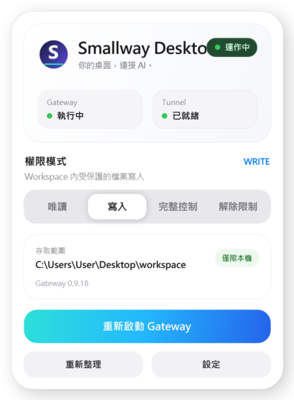
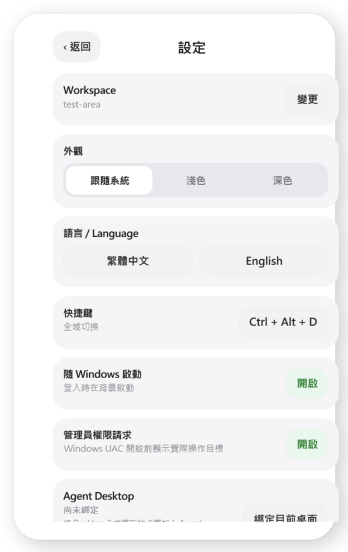

# Smallway Desktop MCP（繁體中文）

[繁體中文](README.zh-TW.md) · [English](README.md)

**Smallway Desktop MCP** 是一套在 Windows 本機執行的 MCP Gateway，讓使用者在明確授權後，透過 ChatGPT 操作指定的檔案、Terminal 與電腦介面。原始專案為 [edmen12/DeskMCP](https://github.com/edmen12/deskmcp)，採用 **Apache License 2.0**；本版本由 Smallway 獨立修改與維護，**不是原作者官方版本，亦不代表原作者認可或提供支援**。

## 介面語言

Windows 控制面板與安裝介面支援 **繁體中文（預設）／English**。

控制面板切換位置：**Settings（設定）→ Language / 語言 → 繁體中文／English**。選擇立即生效，下次啟動仍會記住。必要技術詞彙保留原文，例如 `Gateway`、`Tunnel`、`Workspace`、`MCP`、`SSH`、`API`、`Token` 與 `Agent Desktop`。

## 主要功能

- 一個 Gateway 可管理最多三條 ChatGPT Tunnel。
- 允許使用者授權多個 Workspace，並依權限模式限制本機操作。
- Agent Desktop、Browser Automation，以及桌面操作工具。
- Record to Skill，可在本機錄製操作過程以輔助建立 Skill。
- **Project Connections**：只在使用者指定的專案目錄查找 MD 憑證來源，經本機核准後供 SSH／API 工作使用。憑證仍保存於原 MD，不回傳明文給模型。
- 可由使用者**主動指定** Codex 對話或排程進行接手；此軟體不會自行監控 Codex 額度，也不自動補跑原有排程。

## 安裝與使用

1. 從 [Smallway Desktop MCP Releases](https://github.com/0800happy/smallway-desktop-mcp/releases) 下載對應的 Windows 安裝檔。**尚未公開發布的版本，請勿將上述網址視為已可下載。**
2. 安裝時選擇繁體中文或 English；程式沿用舊版 DesktopMCP 的內部資料路徑，升級前應備份 Workspace、Tunnel 與使用者設定。
3. 初次啟動選擇 Workspace，必要時在 OpenAI Platform 建立 Tunnel，貼上 Tunnel ID 與 Runtime API Key。
4. 在 ChatGPT 裡連線 Smallway Desktop MCP，確認 MCP 工具可用。

預設權限採 **Read-only**；Full Control 與 Fully Unlocked 不會永久保存。**平台級安全限制無法透過改動本程式解除。** 本專案僅適合在使用者合法授權的電腦與遠端服務上操作。

## 授權與聲明

本專案保留上游原始碼歷史、Apache 2.0 `LICENSE`、`NOTICE` 與 `THIRD_PARTY_NOTICES.md`。第三方元件遵守各自授權，原始作者名稱與品牌不因本版重新命名而移除。

本專案 Windows 安裝包若未顯示有效簽章，代表**未簽署版本**，不可視為上游 DeskMCP 的官方簽署產品。

完整技術說明：[English README](README.md) · [Localization](docs/LOCALIZATION.md)。
